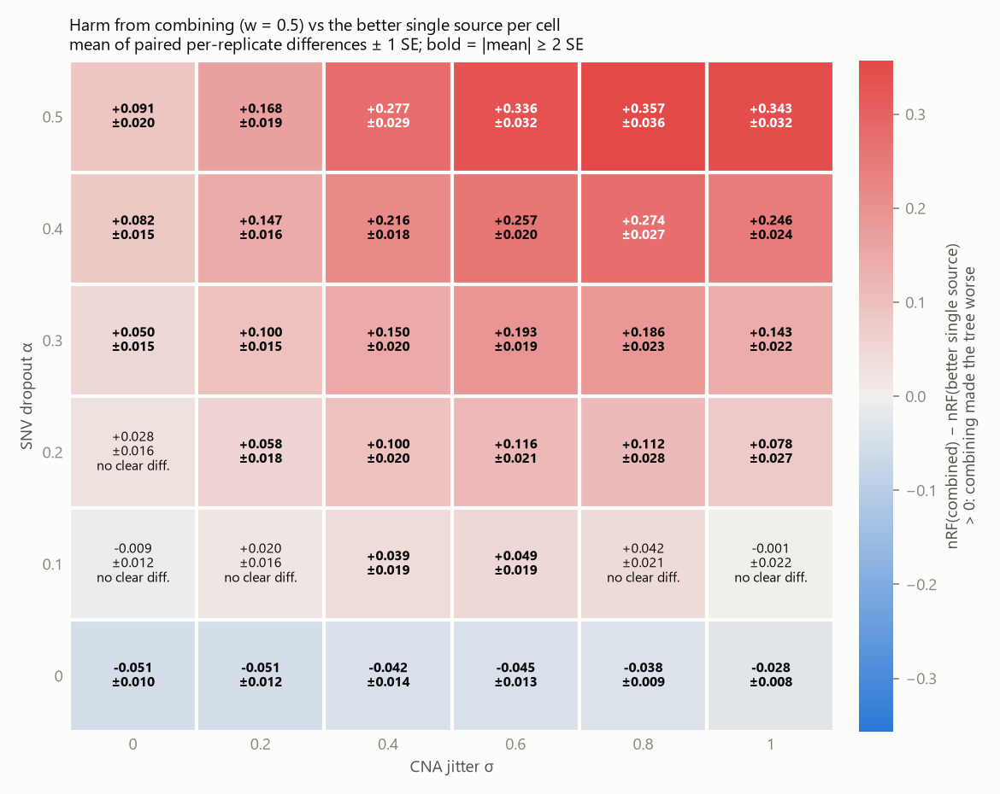

# When do noisy SNVs help tumor tree reconstruction?

A small, honest simulation study. Single-cell tumor data comes in two error-prone kinds:
- **SNVs**: point mutations, which suffer allelic dropout;
- **CNAs**: copy-number profiles, which suffer measurement jitter.

Using a deliberately simple distance-based pipeline, this study asks when **mixing the two distance matrices** rebuilds the tumor tree better than the better single source, and when adding the noisier source makes the tree *worse*. The trees are simulated, so the true tree is known.

The motivation is an NSF-funded UConn project (IIS-2212511; PI Ion Măndoiu, co-PI Mukul Bansal) on inferring tumor phylogenies from low-coverage single-cell DNA data. Its clone profiles include both CNAs and SNVs. This repo is a toy-scale side study, not part of that project. The full spec is in [SPEC.md](SPEC.md).

## Result in one figure



Red cells are settings where averaging SNV and CNA distances (w = 0.5) gave a *worse* tree than the better single source; blue cells are settings where it gave a better one. Numbers are paired mean differences in normalized Robinson–Foulds distance ± 1 SE, over 20 replicates per cell.

- **Combining helps only when SNVs have no dropout** (α = 0, bottom row).
- **From α = 0.2 up, combining is worse than copy number alone** in 23 of 24 settings.

Read the [summary](results/SUMMARY.md), the [full tables](results/tables.md) and the [essay sentence](results/ESSAY_SENTENCE.md). The other figures are the [win map](results/figures/win_map.png) and [nRF vs dropout at σ = 0.4](results/figures/line_sigma0.4.png).

## Pipeline

1. **Tree.** A random binary tree over 40 cells: repeatedly split a uniformly chosen leaf, give each edge an Exp(1) length, and attach labels in random order.
2. **SNVs.** Infinite-sites mutations, Poisson(μ_SNV × length) per edge. Noise: dropout α (1 → 0) and false positives β = 0.01 (0 → 1). All-zero columns are then dropped.
3. **CNAs.** Over 5000 bins, Poisson(μ_CNA × length) segmental ±1 events per edge (5–60 bins each, clipped to [0, 8]). Noise: Normal(0, σ) jitter, kept as floats.
4. **Distances.** Hamming distance for SNVs and L1 for CNAs. Each matrix is normalized to a mean off-diagonal of 1, then mixed as D_w = w·D_SNV + (1 − w)·D_CNA for w ∈ {0, 0.25, 0.5, 0.75, 1}. So w = 0 is CNA-only and w = 1 is SNV-only.
5. **Reconstruction.** Neighbor joining in NumPy with deterministic lowest-index tie-breaking. DendroPy's own `nj_tree()` breaks ties by memory address, so it is not reproducible across processes; the tests show this.
6. **Score.** Normalized Robinson–Foulds distance against the true tree (0 = identical, 1 = no shared splits).

## How it was kept honest

- **Paired design.** Within a replicate, every weight is scored on the same tree and the same noise draw. The 36 (α, σ) cells also share the same 20 trees and clean data (common random numbers), so cells are not independent samples.
- **Calibration before the sweep.** At zero noise, both sources must reach a mean nRF ≤ 0.2 ([results/calibration.txt](results/calibration.txt)): SNV-only scored 0.176 ± 0.009 and CNA-only 0.161 ± 0.011. The spec's original CNA defaults (500 bins, μ_CNA = 1) could not pass (0.553), so the defaults became 5000 bins and μ_CNA = 8. That choice was made from zero-noise runs only.
- **Analysis fixed before the results.** The analysis and figure code was committed (`09c6b42`) before the sweep ran from that clean commit. [results/run_log.txt](results/run_log.txt) freezes the config, calibration and package versions.
- **No tuning on reported data.** The tuned weight (finding 4) is chosen on replicates 0–9 and reported on 10–19.
- **Uncertainty.** All differences are means of paired per-replicate differences ± 1 SE. Anything under 2 SE is called "no clear difference."
- **Spot-check.** Three random result rows were recomputed with loop-based distances and an independent split-set RF; all three match ([results/spot_check.txt](results/spot_check.txt)).

## Run it

Python 3.13:

```bash
python -m venv .venv
```

```bash
.venv/bin/pip install -r requirements.txt
```

(On Windows, use `.venv\Scripts\pip`.) Then, from the repo root:

```bash
python -m pytest
```

```bash
python src/run_sweep.py --calibrate
```

```bash
python src/run_sweep.py
```

```bash
python analysis/plots.py
```

```bash
python analysis/spot_check.py
```

The full sweep (3,600 trees) takes under a minute on a desktop CPU. The test suite has 102 tests, including the determinism check and its positive control.

## Layout

```
SPEC.md                 the spec, corrected against what was found while building
config.yaml             every parameter
src/                    simulate_tree, simulate_snv, simulate_cna, distances,
                        reconstruct (NumPy NJ), evaluate (nRF), run_sweep
analysis/               stats.py (paired statistics), plots.py (figures + tables),
                        spot_check.py
results/                results.csv, run_log.txt, calibration.txt, tables.md,
                        cell_summary.csv, holdout_best_w.csv, SUMMARY.md,
                        ESSAY_SENTENCE.md, spot_check.txt, figures/
tests/test_pipeline.py  stage tests from SPEC.md Section 7
```

## Limitations

- **Naive combination.** A weighted sum of distances is not how model-based methods work. COMPASS fits a joint likelihood over SNV and CNA read counts, with dropout and doublets. SCARLET models SNV read-count error on a given copy-number tree. This study tests only the naive approach.
- **No SNV–CNA interaction.** In real tumors, deleting the copy that carries an SNV erases it. Here the two processes are independent.
- **Simplified noise.** There are no doublets, no missing data and no breakpoint-boundary errors. β is fixed at 0.01, and false positives only land on sites that really mutated somewhere.
- **Distance-based only.** Neighbor joining is one method. The Bansal lab's DICE is also distance-based but CNA-only, and uses balanced minimum evolution.
- **Small scale.** 40 cells, versus hundreds to thousands in current single-cell DNA datasets.
- **Calibration sets the balance.** With 5000 bins, CNA jitter up to σ = 0.6 barely moved CNA-only, while SNV dropout hurt SNV-only a lot. Different rates, bin counts or noise models could shift where combining helps.
- **Selection in the harm map.** The "better single source" in each cell is picked from the same 20 replicates it is compared on. Finding 4's holdout avoids that selection and reaches the same conclusion.

## Related work

- ScisTreeCNA (Zhang & Wu, bioRxiv 2025, doi:10.1101/2025.11.21.689819)
- Pharming (Weber et al., *J Comput Biol* 2026, doi:10.1177/15578666251374694)
- COMPASS (Sollier et al., *Nat Commun* 2023, doi:10.1038/s41467-023-40378-8)
- SCARLET (Satas et al., *Cell Systems* 2020)
- DICE (Weiner & Bansal, *Life Sci Alliance* 2025)
- CNAsim (Weiner & Bansal, *Bioinformatics* 2023)
